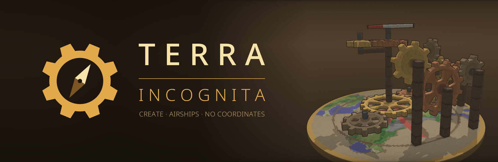

<p align="center">
  
</p>

<p align="center">
  
  
  
  
</p>

<p align="center">
  <b>English</b> · <a href="#ru">Русский</a>
</p>

# Terra Incognita

**A Create modpack where nobody knows where they are.**

There are no coordinates in this world. Not on F3, not in chat, not in commands, not on a
compass. You leave home and you have to remember the way back. You want to meet a friend and
you have to explain where you are in words: "past the lake, by the tall tower, look for smoke".

The pack is made for a small server of friends. It is still in development.

## Why play it

**Getting lost is part of the game.** The map stays blank until you walk it yourself. Towers,
lamps in the fog, roads and railways stop being decoration and become the way you navigate.

**Talking takes equipment.** Text chat reaches 60 blocks. To speak across the world you craft a
radio and tune it to a frequency. Whoever is on the same frequency hears you, with static and
all. No radio means no long-distance voice.

**Industry is the long road.** Progress goes from andesite and water wheels to brass, electricity,
trains and heavy industry. Recipes are harder than usual and tied together, so each stage gives
you a reason to build a real factory, not a one-block machine.

**The sky is open.** Airships and flying machines are built from blocks, piece by piece. In a
world without coordinates, a view from above is worth a lot.

## What is inside

| | |
|---|---|
| **Machines** | Create and its addons, Immersive Engineering |
| **Steel and oil** | Create: The Factory Must Grow. One steel and one oil for the whole pack |
| **Air and war** | Create Aeronautics, Big Cannons, radars |
| **World** | Oh The Biomes We've Gone, new trees and structures |
| **Home life** | Farmer's Delight, Vinery, decoration blocks, a working photo camera |
| **Guidance** | FTB Quests, JEI |
| **Our own mod** | Incognita: hidden coordinates, random respawn, radio, multiblock projector |

The full list with versions is in [`mods/manifest.txt`](mods/manifest.txt).

## Status

Working now: hidden coordinates, random respawn, the radio, the first reworked recipes, the
steel and oil chain. In progress: quests, recipe gates between stages, in-world navigation tools.

## For developers

The repository holds configs (`conf/`), KubeJS scripts (`kubejs/`), the mod list (`mods/`) and
the source of the Incognita mod (`custom_mods/incognita/`). Jars of other mods are not stored here.

```bash
script/build-mod.sh                  # build Incognita (JDK 21)
script/build-cf-pack.py              # zip for the CurseForge app, lands in dist/
```

## License

GNU LGPL v3 or later, see [LICENSE](LICENSE).

---

<a name="ru"></a>

<p align="center">
  <a href="#terra-incognita">English</a> · <b>Русский</b>
</p>

# Terra Incognita (на русском)

**Сборка на Create, в которой никто не знает, где находится.**

В этом мире нет координат. Ни на F3, ни в чате, ни в командах, ни на компасе. Ушёл из дома —
запоминай дорогу назад. Хочешь встретиться с другом — объясняй словами: «за озером, у высокой
вышки, ищи дым».

Сборка делается для небольшого сервера с друзьями. Она ещё в разработке.

## Зачем в это играть

**Заблудиться — часть игры.** Карта пустая, пока сам её не пройдёшь. Вышки, лампы в тумане,
дороги и рельсы перестают быть украшением: по ним ориентируются.

**Для связи нужна техника.** Текстовый чат слышен на 60 блоков. Чтобы говорить через весь мир,
нужно скрафтить рацию и настроить частоту. Кто на той же частоте, тот тебя слышит, с помехами и
шипением. Нет рации — нет дальней связи.

**Индустрия — долгая дорога.** Развитие идёт от андезита и водяных колёс к латуни, электричеству,
поездам и тяжёлой промышленности. Рецепты сложнее обычных и связаны между собой, поэтому на
каждом этапе есть смысл строить настоящий завод, а не машину в один блок.

**Небо открыто.** Дирижабли и летающие машины собираются из блоков, по детали. В мире без
координат вид сверху дорого стоит.

## Что внутри

| | |
|---|---|
| **Механизмы** | Create с аддонами, Immersive Engineering |
| **Сталь и нефть** | Create: The Factory Must Grow. Одна сталь и одна нефть на всю сборку |
| **Воздух и война** | Create Aeronautics, Big Cannons, радары |
| **Мир** | Oh The Biomes We've Gone, новые деревья и структуры |
| **Быт** | Farmer's Delight, Vinery, декоративные блоки, рабочий фотоаппарат |
| **Подсказки** | FTB Quests, JEI |
| **Наш мод** | Incognita: скрытые координаты, случайный респавн, рация, проектор мультиблоков |

Полный список с версиями лежит в [`mods/manifest.txt`](mods/manifest.txt).

## Состояние

Уже работает: скрытые координаты, случайный респавн, рация, первые переделанные рецепты, цепочка
стали и нефти. В работе: квесты, рецептурные ступени между этапами, средства навигации в мире.

## Разработчикам

В репозитории лежат конфиги (`conf/`), скрипты KubeJS (`kubejs/`), список модов (`mods/`) и
исходники мода Incognita (`custom_mods/incognita/`). Jar-файлы чужих модов здесь не хранятся.

```bash
script/build-mod.sh                  # собрать Incognita (JDK 21)
script/build-cf-pack.py              # zip для лаунчера CurseForge, появится в dist/
```

## Лицензия

GNU LGPL v3 или новее, см. [LICENSE](LICENSE).
